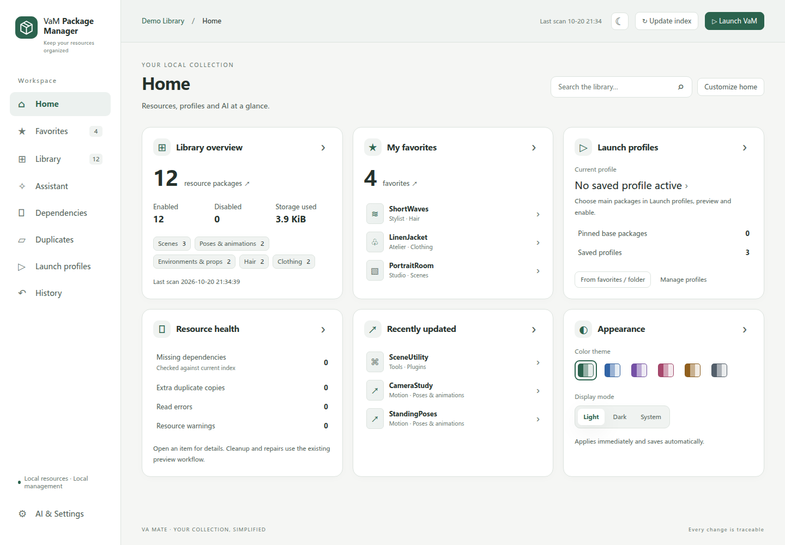
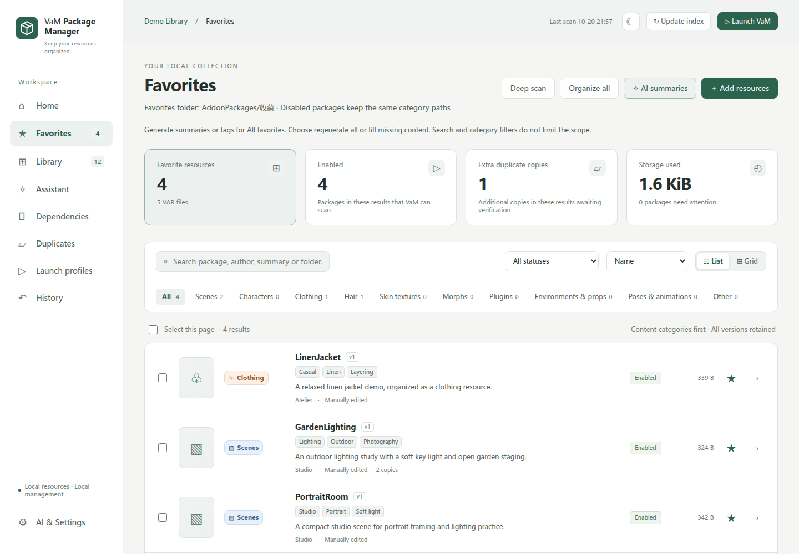
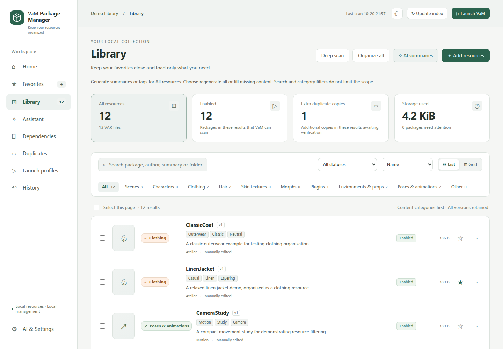
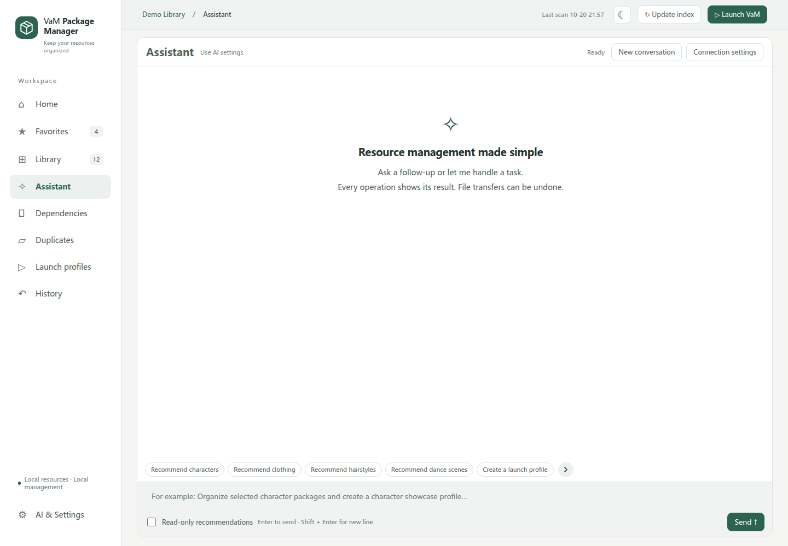
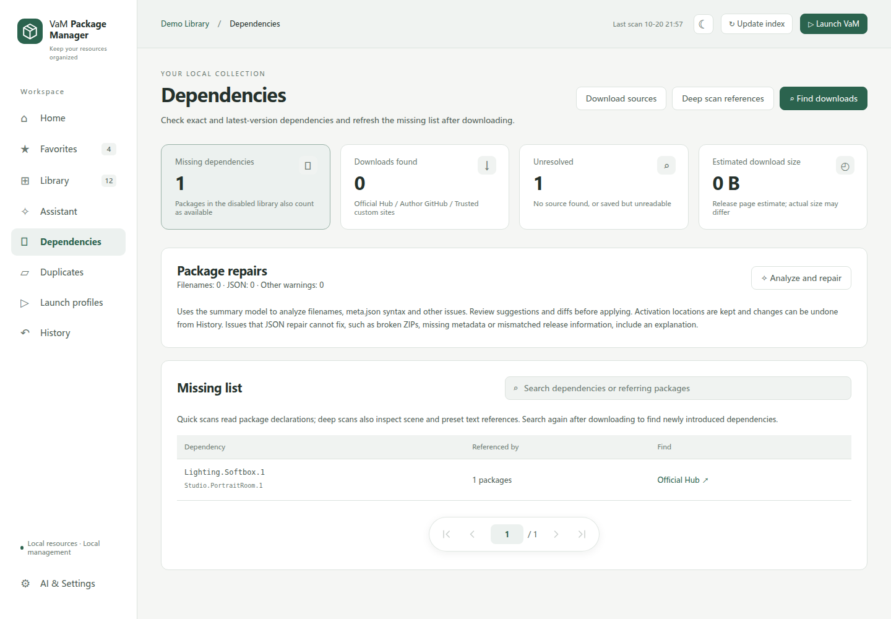
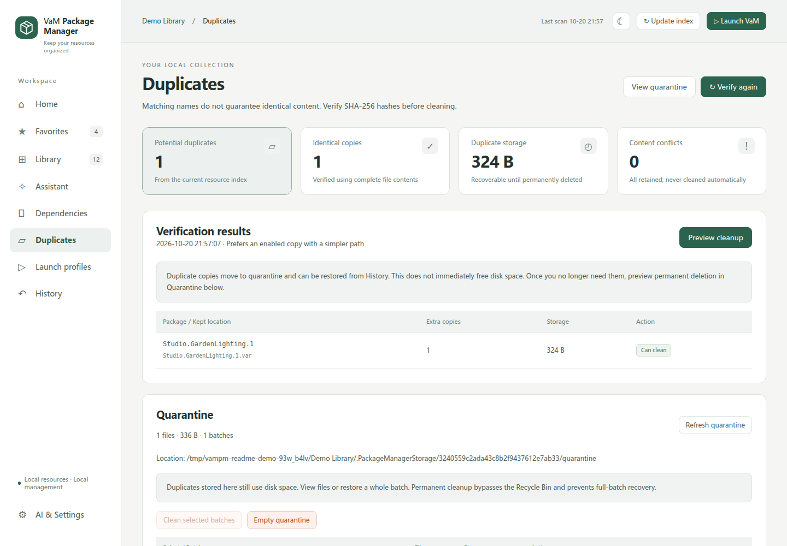
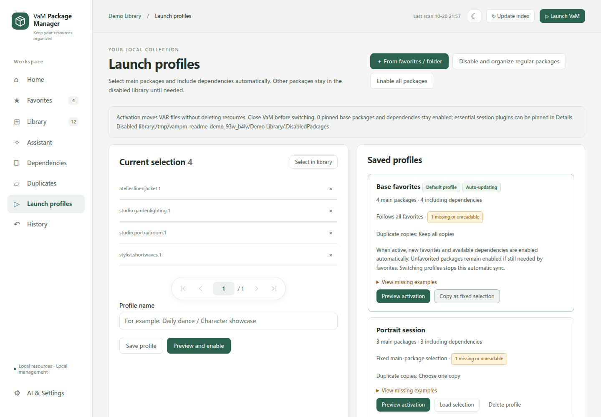
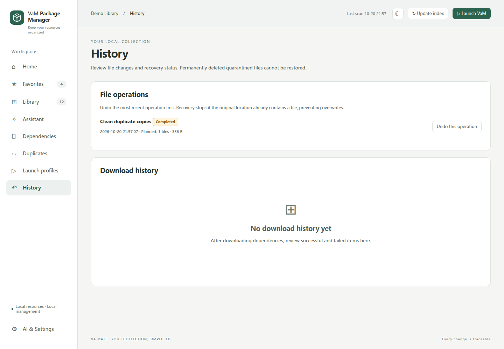
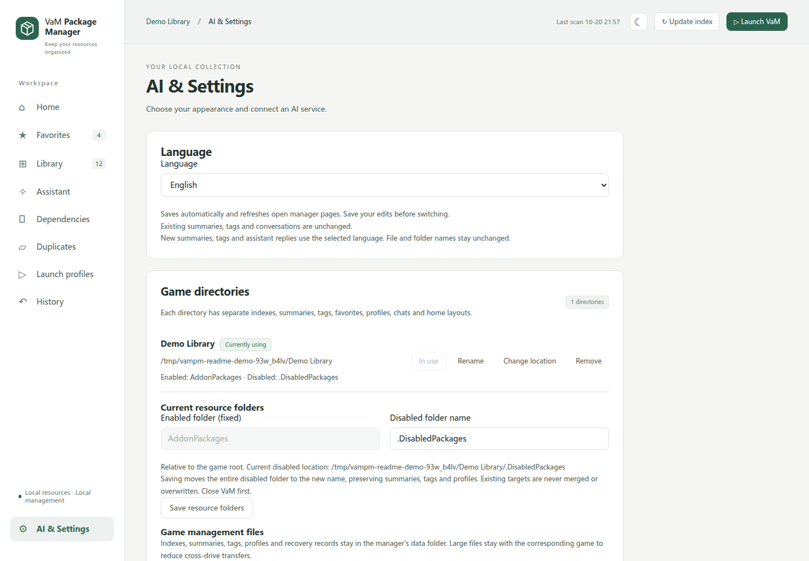

# VaM Package Manager

**English** | [简体中文](README.zh-CN.md)

A local VAR library manager for **Virt-A-Mate (VaM)** on Windows. Organize resources, resolve dependencies, prepare launch profiles, and optionally use AI to describe and explore your collection.

**Version 1.0.0** · **Windows x64** · [MIT License](LICENSE)



*Screenshots show the running application with a synthetic demonstration library. No personal library, credentials, or third-party game assets are shown.*

[Features](#features) · [Interface tour](#interface-tour) · [Getting started](#getting-started) · [AI setup](#ai-setup) · [Storage and backups](#storage-and-backups) · [Development](#development) · [License](#license)

## Features

- **Browse and organize:** searchable lists and cover grids, categories, favorites, descriptions, content tags, and package details. Archive an entire library or favorites collection without selecting every package.
- **Manage multiple installations:** switch between saved VaM roots, each with its own index, descriptions, tags, profiles, and conversations. Remove a directory from the list without deleting its data, or rebind it after moving the game.
- **Build launch profiles:** use a fixed selection, a folder, or all favorites; include available dependencies and keep pinned base packages enabled.
- **Inspect dependencies and duplicates:** find missing dependencies, configure download sources, and quarantine verified duplicate content. Review, restore, or permanently clear quarantine batches in the app.
- **Preview file operations:** review planned changes and use operation history to restore supported operations. Cross-drive transfers verify copied content before removing the source.
- **Use AI when needed:** generate descriptions and tags separately or together, get resource recommendations, and chat with an assistant that retains context. Choose read-only recommendations or allow supported management actions.
- **Make the interface yours:** customizable home cards, six color palettes, light/dark/system appearance, and English or Simplified Chinese. Language changes affect the UI and newly generated AI content; existing user content and filenames stay unchanged.

## Interface tour

Eight pages beyond Home, grouped by workflow. Click any screenshot to view it at full size. Settings is shown at the top of the page; appearance and AI controls continue below.

### Browse and discover
<table>
<tr>
<td width="50%" valign="top">
<a href="docs/images/favorites-en.png"></a>
<strong>Favorites</strong>
<p>Keep frequently used packages together, filter your collection, and archive favorites in one action.</p>
</td>
<td width="50%" valign="top">
<a href="docs/images/library-en.png"></a>
<strong>Library</strong>
<p>Browse resources in lists or cover grids; search descriptions and tags, inspect details, and manage activation.</p>
</td>
</tr>
<tr>
<td width="50%" valign="top">
<a href="docs/images/assistant-en.png"></a>
<strong>Assistant</strong>
<p>Explore your library through a conversation, start with built-in prompts, and choose read-only recommendations when needed.</p>
</td>
<td width="50%" valign="top">
<a href="docs/images/dependencies-en.png"></a>
<strong>Dependencies</strong>
<p>See missing packages and what references them, configure download sources, and review supported repair suggestions.</p>
</td>
</tr>
</table>

### Maintain and configure
<table>
<tr>
<td width="50%" valign="top">
<a href="docs/images/duplicates-en.png"></a>
<strong>Duplicates & quarantine</strong>
<p>Verify duplicate content before cleanup, inspect quarantined batches, and restore or permanently remove them.</p>
</td>
<td width="50%" valign="top">
<a href="docs/images/profiles-en.png"></a>
<strong>Launch profiles</strong>
<p>Save resource selections or follow favorites and folders; preview activation with available dependencies included.</p>
</td>
</tr>
<tr>
<td width="50%" valign="top">
<a href="docs/images/history-en.png"></a>
<strong>History</strong>
<p>Review file operations and their results, restore supported changes, and inspect dependency download records.</p>
</td>
<td width="50%" valign="top">
<a href="docs/images/settings-en.png"></a>
<strong>AI & Settings</strong>
<p>Switch game directories and interface language, customize appearance, and configure AI providers and models.</p>
</td>
</tr>
</table>

## Getting started

### Requirements

| Use | Requirements |
| --- | --- |
| Manage a library | Windows x64, a local VaM installation containing `AddonPackages`, and a modern browser |
| Run from source | Python 3.13; the backend uses the standard library |
| Build the Windows launcher | Windows PowerShell and the .NET Framework 4.x C# compiler used by `tools/build.ps1` |
| Develop/test the Web UI | Node.js 20+ and npm; unnecessary for ordinary app use |
| Use AI | A configured API service or a working Codex CLI installation and authentication |

VaM and game resources are **not included**. This is an independent community tool, not an official VaM product.

### Run from source

Download or clone this repository, open PowerShell in its root, and point the application at an existing VaM directory:

```powershell
py -3.13 src\main.py --game "C:\Games\VaM"
```

The browser opens a local, authenticated session. Keep the console running while using the source version. The app creates its own `data/` directory on first launch.

To build the English-named launcher and prepare its adjacent runtime:

```powershell
py -3.13 tools\prepare_runtime.py
# Optional: prepare an app-local Codex CLI for the Codex provider.
# py -3.13 tools\prepare_codex.py
powershell -NoProfile -ExecutionPolicy Bypass -File tools\build.ps1
```

The preparation scripts download pinned distributions and verify their hashes. The build produces `VaMPackageManager.exe`. Keep it alongside `src/`, `web/`, and `runtime/`; the EXE alone is not a standalone application.

### Portable packages

This source repository does **not** contain an EXE or runtime. If a portable archive is provided in the repository's **Releases** section, extract the complete application folder and launch `VaMPackageManager.exe`. GitHub's automatically generated **Source code** archives are not portable builds.

Placing the application folder directly inside a VaM root lets the launcher discover that root initially. Additional game directories can be added in **AI & Settings → Game directories**.

### First session

1. Close VaM before operations that move resources or change activation.
2. Select the intended game directory and choose **Update index**. Deep scanning also checks references inside supported package files.
3. Browse resources, inspect dependencies, and add favorites. Configure AI only if you want its optional features.
4. Create a launch profile, review its activation preview, and apply it. Saving a profile alone does not activate it.
5. Launch VaM after file operations finish. Use **History** for supported restoration, or **Duplicates → Quarantine** to inspect isolated copies.

**Permanently clearing quarantine bypasses the Recycle Bin and cannot be undone.** Keep backups before large reorganizations; operation history does not replace a backup.

## AI setup

Open **AI & Settings** and select **Codex**, **DeepSeek**, or an **OpenAI-compatible API**. Chat and description generation can use different models.

- For a compatible API, enter its base URL and API key. Refresh the model list, search by part of a model name, or type an exact model ID if discovery is unavailable.
- For Codex, prepare or select a working CLI and use the application's sign-in controls. Account access and quotas are governed by the provider.
- Model capabilities are shown with available evidence and can be corrected manually. Not every compatible endpoint supports tools, images, or model discovery.
- Choose **read-only recommendations** in the assistant when you want inspection and suggestions without management actions.

AI requests can send relevant package metadata, descriptions, selected content excerpts, conversation context, and enabled cover images to the chosen provider. API calls and context summarization may incur charges. Cache statistics reflect provider-reported usage when available; a particular cache hit rate is not guaranteed.

Switch language in **AI & Settings → Language**. Built-in, unedited chat presets and the default profile's display name follow the interface language. Custom presets, existing descriptions/tags, conversation history, package names, and file/folder names remain unchanged. Already-running generation jobs retain their starting language.

## Storage and backups

| Location | Contents |
| --- | --- |
| `<application>/data/` | Directory registry, indexes, settings, descriptions, tags, favorites, profiles, conversations, and recovery records |
| `<application>/data/workspaces/<id>/` | Separate metadata for additional game directories |
| `<game>/AddonPackages/` | Enabled packages; this folder name is fixed |
| `<game>/.DisabledPackages/` | Default disabled-package library; configurable per game |
| `<game>/.PackageManagerStorage/<owner-id>/` | Import/download staging and quarantine for the corresponding manager data |

Existing installations may retain legacy storage locations until explicitly migrated in settings. Moving a game requires preserving its disabled library and `.PackageManagerStorage`; then use the directory's rebind controls. Removing a saved directory only removes the active binding, not its files or retained metadata.

Back up the **entire application `data/` directory and the managed game folders together**. Never publish `data/`, account files, logs, or personal resource libraries. API keys are protected with Windows DPAPI on Windows; a different Windows account or machine may require entering them again.

The UI is served on loopback with a session token. Keep that token private and do not expose the local server through a public proxy. AI and download features use external services; core library management does not require an AI account.

## Development

Application code lives in `src/`, static UI assets in `web/`, the Windows launcher in `launcher/`, and preparation/build scripts in `tools/`.

From the repository root:

```powershell
py -3.13 -m unittest discover -s tests -p "test_*.py" -v
npm ci
npx playwright install chromium
npm run test:ui
```

The browser suite invokes `python3`; ensure that command resolves to Python 3.13 in your test environment. On Linux/WSL, use `python3` for backend tests and install Chromium's system dependencies if needed. Windows is the application target; Linux/WSL is useful for isolated tests, not a supported substitute for Windows game integration.

Browser assets are already vendored. After intentionally updating their locked dependencies, run `python tools/prepare_web.py` and retain upstream license files. After editing translation catalogs, run `python tools/build_locales.py`.

Ordinary unit/browser tests use temporary fixtures and do not make paid AI calls. `tests/live_*.py` and historical `tests/windows_*.js` probes are separate manual tools; review their requirements before running them. See [CONTRIBUTING.md](CONTRIBUTING.md) for contribution and testing guidance.

## Support and contributing

Use the repository's **Issues** tab for reproducible bugs and feature requests. Include the app version, Windows version, steps to reproduce, and sanitized diagnostics. Do not attach your complete `data/` directory or copyrighted game packages.

Pull requests are welcome. Keep changes focused, preserve recovery behavior, and update both README languages when user-facing instructions change. For sensitive reports, follow [SECURITY.md](SECURITY.md).

## License

Original project code and documentation are licensed under the **[MIT License](LICENSE)**. Third-party components retain their own licenses; see [THIRD_PARTY_NOTICES.md](THIRD_PARTY_NOTICES.md).

VaM, user resources, provider services, and account credentials are not covered by this project's license. Respect the licenses and access conditions of the resources you manage.
