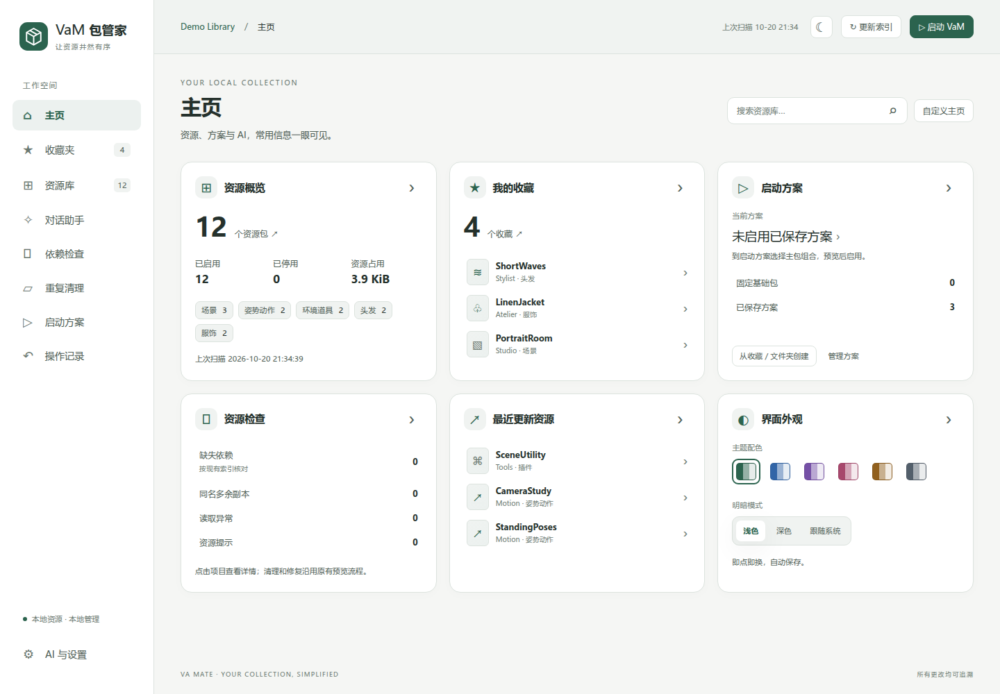
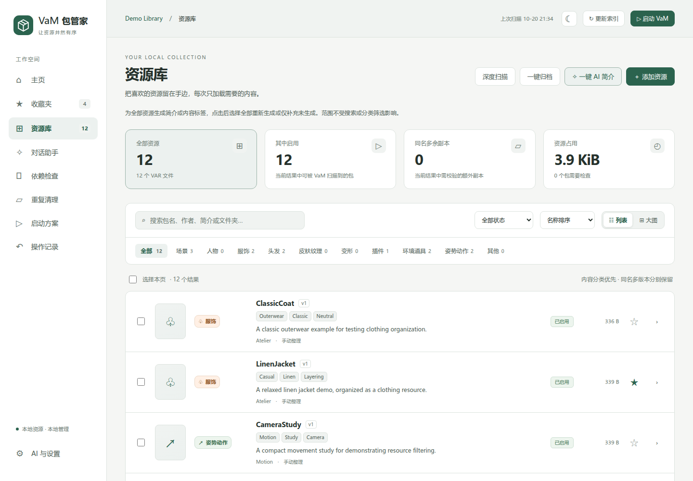

# VaM 包管家

[English](README.md) | **简体中文**

面向 Windows 的 **Virt-A-Mate（VaM）** 本地 VAR 资源管理工具。整理资源、检查依赖、配置启动方案，也可以通过可选的 AI 功能生成简介、标签和资源推荐。

**版本 1.0.0** · **Windows x64** · [MIT 开源许可](LICENSE)



*截图来自实际运行的应用，使用独立的模拟演示资源库，不包含个人资源库、凭据或第三方游戏素材。*

[功能](#功能) · [开始使用](#开始使用) · [AI 设置](#ai-设置) · [数据位置与备份](#数据位置与备份) · [开发](#开发) · [开源许可](#开源许可)

## 功能

- **浏览与整理**：支持列表、封面网格、搜索、分类、收藏、简介、内容标签和详情。资源库与收藏夹均可一键归档，无需逐个选择。
- **多个游戏目录**：保存并切换不同 VaM 安装目录，各自保留索引、简介、标签、方案和对话。移除登记不删除数据；游戏搬家后可以重新绑定。
- **按需启动方案**：支持固定选择、文件夹和全部收藏三种来源，包含可用依赖，固定基础包常驻启用。
- **依赖与重复检查**：查找缺失依赖、配置下载来源，将校验一致的重复内容移入隔离区。在应用内查看、恢复或永久清理隔离批次。
- **可预览的文件操作**：执行前检查移动计划，通过操作记录恢复受支持的操作。跨磁盘移动先复制并校验内容，再删除源文件。
- **可选 AI 辅助**：分别或同时生成简介与标签，推荐资源，并通过保留上下文的助手继续对话。支持只读推荐及受支持的资源管理操作。
- **界面自定义**：可增删、排列的主页卡片，六种配色，浅色/深色/跟随系统，以及中英文界面。切换语言仅影响界面和后续 AI 输出，已有用户内容及文件名保持原样。

<details>
<summary>查看资源库截图</summary>



</details>

## 开始使用

### 环境要求

| 用途 | 要求 |
| --- | --- |
| 管理资源 | Windows x64、包含 `AddonPackages` 的本地 VaM 安装目录及现代浏览器 |
| 从源码运行 | Python 3.13；后端仅使用标准库 |
| 编译 Windows 启动器 | Windows PowerShell，以及 `tools/build.ps1` 使用的 .NET Framework 4.x C# 编译器 |
| 开发和测试 Web 界面 | Node.js 20+ 与 npm；日常使用不需要 |
| 使用 AI | 已配置的 API 服务，或可用且已完成认证的 Codex CLI |

本项目**不包含 VaM 或游戏资源**，是独立的社区工具，并非 VaM 官方产品。

### 从源码运行

下载或克隆本仓库，在仓库根目录打开 PowerShell，指定已有的 VaM 游戏目录：

```powershell
py -3.13 src\main.py --game "C:\Games\VaM"
```

程序会打开带本地会话认证的浏览器页面。从源码运行时，请保持控制台运行；首次启动会创建管家自己的 `data/` 目录。

准备运行时并编译英文名称的启动器：

```powershell
py -3.13 tools\prepare_runtime.py
# 可选：为 Codex 服务准备应用内置的 CLI。
# py -3.13 tools\prepare_codex.py
powershell -NoProfile -ExecutionPolicy Bypass -File tools\build.ps1
```

准备脚本会下载固定版本的发行文件并校验哈希。构建后得到 `VaMPackageManager.exe`。必须保留同目录下的 `src/`、`web/` 和 `runtime/`，**只复制 EXE 无法独立运行**。

### 便携发行包

源码仓库**不包含 EXE 或运行时**。如果维护者在仓库的 **Releases** 页面提供便携压缩包，请完整解压应用文件夹，再打开 `VaMPackageManager.exe`。GitHub 自动提供的 **Source code** 压缩包是源码，不是编译后的便携程序。

将应用文件夹放在 VaM 游戏根目录内，可在首次启动时自动找到该游戏；其他游戏目录可在 **AI 与设置 → 游戏目录** 中添加。

### 首次使用

1. 涉及移动资源或更改启用状态前，先关闭 VaM。
2. 选择目标游戏目录，点击**更新索引**。深度扫描还会检查受支持文件中的依赖引用。
3. 浏览资源、查看依赖、添加收藏；仅在需要时配置可选的 AI 功能。
4. 创建启动方案，查看启用预览后再执行。保存方案本身不会立即改变启用状态。
5. 文件操作完成后再启动 VaM。在**操作记录**中恢复受支持的操作，或到**重复清理 → 隔离区**查看隔离副本。

**永久清理隔离区不经过回收站，无法撤销。** 大规模整理前请保留备份，操作记录不能代替备份。

## AI 设置

在 **AI 与设置** 中选择 **Codex**、**DeepSeek** 或**其他 OpenAI 兼容 API**。对话与简介生成可以使用不同模型。

- 兼容 API：填写基础地址与 API Key，刷新模型列表，输入部分名称匹配；接口不提供模型列表时，可直接输入完整模型 ID。
- Codex：准备或选择可用的 CLI，通过应用中的登录入口完成认证。账号权限与额度由服务商决定。
- 模型能力会显示可用的判断依据，也可以手动修正。兼容接口不一定支持工具调用、图片或模型列表查询。
- 只需要查询与建议时，可在助手中启用**只读推荐**，限制管理操作。

AI 请求可能向所选服务商发送相关包的元数据、简介、选取的内容片段、对话上下文，以及启用识图时的封面。API 调用和上下文摘要可能消耗额度或产生费用。缓存统计在服务商提供数据时展示实际用量信息，不保证固定命中率。

在 **AI 与设置 → 语言 / Language** 切换语言。未改写的内置对话预设和默认方案的显示名称会跟随切换；自定义预设、已有简介和标签、聊天记录、包名、文件及文件夹名称均保持原样。已在进行的生成任务沿用启动时的语言。

## 数据位置与备份

| 位置 | 内容 |
| --- | --- |
| `<管家目录>/data/` | 游戏目录登记、索引、设置、简介、标签、收藏、方案、对话及恢复记录 |
| `<管家目录>/data/workspaces/<ID>/` | 其他游戏目录各自独立的元数据 |
| `<游戏目录>/AddonPackages/` | 已启用资源，目录名称固定 |
| `<游戏目录>/.DisabledPackages/` | 默认停用库，可按游戏目录自定义 |
| `<游戏目录>/.PackageManagerStorage/<归属ID>/` | 对应管家数据使用的导入暂存、下载暂存及隔离区 |

旧安装可能继续使用原存储位置，直到在设置中明确执行迁移。移动游戏时，应一并保留停用库和 `.PackageManagerStorage`，然后使用目录重新绑定功能。移除已保存的游戏目录只解除使用绑定，不删除文件或保留的元数据。

备份时，请**同时保留完整的管家 `data/` 与所管理的游戏文件夹**。不要公开上传 `data/`、账号文件、日志或个人资源库。Windows 下的 API Key 使用 DPAPI 保护，更换 Windows 账号或电脑后可能需要重新填写。

页面服务仅监听本机回环地址，并使用会话令牌认证。请保密会话令牌，不要通过公共代理暴露本地服务。AI 与下载功能会访问外部服务；基础资源管理无需 AI 账号。

## 开发

`src/` 为应用代码，`web/` 为静态界面，`launcher/` 为 Windows 启动器，`tools/` 为运行环境准备和构建脚本。

在仓库根目录执行：

```powershell
py -3.13 -m unittest discover -s tests -p "test_*.py" -v
npm ci
npx playwright install chromium
npm run test:ui
```

浏览器测试会调用 `python3`，请确保测试环境中的该命令指向 Python 3.13。Linux/WSL 下可用 `python3` 执行后端测试，并按需安装 Chromium 的系统依赖。应用面向 Windows；Linux/WSL 用于隔离测试，不代表支持在这些平台替代 Windows 的游戏集成。

仓库已包含前端依赖文件。明确更新锁定依赖后，运行 `python tools/prepare_web.py` 并保留上游许可证；修改翻译词典后，运行 `python tools/build_locales.py`。

常规单元测试与浏览器测试使用临时模拟资源，不调用付费 AI。`tests/live_*.py` 和历史 `tests/windows_*.js` 是独立的手动工具，运行前请先阅读其要求。更多贡献与测试说明见 [CONTRIBUTING.md](CONTRIBUTING.md)。

## 反馈与贡献

请通过仓库的 **Issues** 页面反馈可复现的问题或功能建议，附上应用版本、Windows 版本、复现步骤及已脱敏的诊断信息。不要上传完整 `data/` 或受版权保护的游戏资源包。

欢迎提交 Pull Request。请保持改动范围清晰，保留操作恢复能力；用户使用说明变化时，同步更新两种 README。涉及敏感信息的报告请参考 [SECURITY.md](SECURITY.md)。

## 开源许可

项目原创代码与文档采用 **[MIT License](LICENSE)**。第三方组件仍遵循各自的许可，详见 [THIRD_PARTY_NOTICES.md](THIRD_PARTY_NOTICES.md)。

VaM、用户资源、服务商的服务与账号凭据不属于本项目许可范围。请遵守所管理资源的许可和访问条件。
